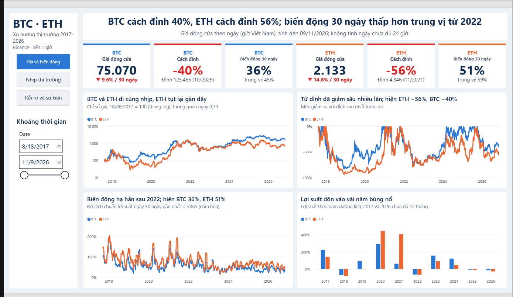

[Tiếng Việt](README.vi.md)

# BTC and ETH, 2017–2026: you can't predict the price, but you can measure the risk

Nine years of hourly price data for Bitcoin and Ethereum on Binance, used to answer three questions: how do the two coins behave, where does the risk concentrate, and how should risk limits be set to withstand it. The project describes what has already happened. It does not forecast prices.



## Key findings

- **Holding for a long time pays off, but you have to survive deep drawdowns.** Since 2017, BTC is up 17.7x and ETH 7.1x. Yet BTC once fell 83% from its peak and took about 3 years to get back to its old price.
- **Risk follows clear patterns.** Hours with abnormal price jumps occur about 7 times more often than a normal distribution implies. Volatility comes in waves, is strongest around 9 pm Vietnam time, and is calmer on weekends. BTC and ETH move almost in lockstep (correlation 0.79).
- **Price direction can't be predicted.** Time of day, trading volume and buy-order flow don't signal whether the price will rise or fall next, and the small edge that remains doesn't cover trading fees.

So the report recommends managing risk (set limits from recent realized volatility, keep leverage low, watch the right hours) instead of trying to predict prices.

## What I did carefully

- **Disciplined hypothesis testing.** 12 hypotheses, each with a practical-significance threshold declared before running, and a correction for multiple testing (Holm). That makes labels like "strong", "weak" or "inconclusive" defensible. I also state which tests sit close to the threshold and could change the conclusion.
- **Cleaning without deleting data.** Problem rows are flagged, not removed, and every decision has a reason. For example, I don't fill exchange-maintenance gaps because that would be inventing data, and I keep the hours of extreme volatility because they are real market events. Details in [docs/data_and_cleaning.md](docs/data_and_cleaning.md).
- **Consistent numbers with a stated cutoff.** The report states its data cutoff (2026-11-09), the test results and the descriptive numbers run on the same cutoff, and every step can be re-run with a few commands.

## Pipeline

Binance → MySQL (quality checks and cleaning in SQL) → Python (EDA, hypothesis tests) → Power BI (3-page dashboard) → report.

## Re-running

Requires Python 3.10+ and MySQL 8.

```bash
pip install -r requirements.txt

python python/update_data.py        # (optional) pull new data from Binance
python python/load_to_mysql.py      # load the csv into MySQL
# in MySQL Workbench, run in order: sql/02, sql/03, sql/04
python python/export_clean_csv.py   # export the cleaned table to csv
```

Then run the notebooks in `notebooks/`. To view the dashboard, open the `.pbix` file in `dashboard/` and click Refresh.

## Documentation

- [Full report](reports/) (Word, in Vietnamese)
- [Data and cleaning](docs/data_and_cleaning.md)
- [Power BI dashboard](dashboard/) (in Vietnamese)

## Notes

- The report stops at data from 2026-11-09. The dashboard uses the latest data, so current prices may differ slightly.
- The results hold for these two coins, on one exchange, across three price cycles since 2017. They may not hold for other coins or other periods.
- The explanations for the major rises and falls are my own interpretation based on the news at the time.

## Author

Nguyễn Văn Nam · MySQL, Python (pandas, scipy), Power BI
