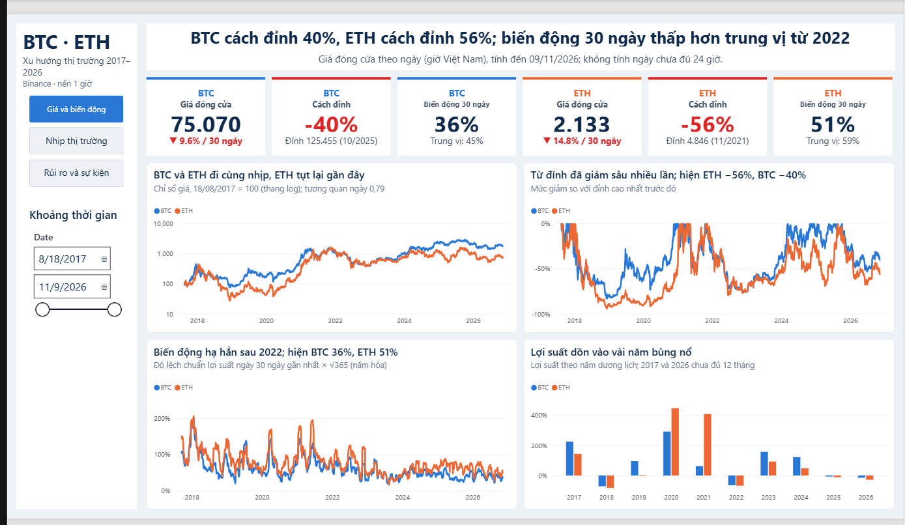

[English](README.md)

# BTC và ETH 2017–2026: không đoán được giá, nhưng đo được rủi ro

Dùng 9 năm dữ liệu giá theo từng giờ của Bitcoin và Ethereum trên Binance để trả lời: hai đồng này biến động thế nào, rủi ro dồn vào đâu, và nên đặt hạn mức ra sao để chịu được. Dự án chỉ mô tả những gì đã xảy ra, không dự đoán giá.



## Kết luận chính

- **Giữ lâu thì lãi, nhưng phải chịu được lỗ sâu.** Từ 2017, BTC tăng gấp 17,7 lần và ETH gấp 7,1 lần, nhưng BTC từng tụt 83% so với đỉnh và mất khoảng 3 năm mới về lại giá cũ.
- **Rủi ro có quy luật rõ.** Giờ giá nhảy bất thường nhiều gấp khoảng 7 lần mức lý thuyết, biến động đi theo từng đợt, mạnh nhất khoảng 21h giờ Việt Nam và êm hơn vào cuối tuần. BTC và ETH đi gần như cùng chiều (hệ số 0,79).
- **Hướng giá thì không đoán được.** Giờ trong ngày, khối lượng, lượng lệnh mua đều không báo trước được giá lên hay xuống, và phần lợi nhỏ còn lại không bù nổi phí giao dịch.

Vì vậy báo cáo khuyên quản lý rủi ro (đặt hạn mức theo dao động thực tế, giữ đòn bẩy thấp, theo dõi đúng giờ) thay vì cố đoán giá.

## Điểm mình làm kỹ

- **Kiểm định có kỷ luật.** 12 giả thuyết được khai báo ngưỡng ý nghĩa thực tế trước khi chạy, có hiệu chỉnh cho việc kiểm nhiều lần (Holm), nên kết luận "mạnh", "yếu" hay "chưa kết luận" đều có cơ sở. Mình cũng ghi rõ phép thử nào sát ngưỡng và có thể đổi kết luận.
- **Làm sạch không xóa dữ liệu.** Dòng nào có vấn đề thì gắn cờ, mỗi quyết định có lý do. Ví dụ không điền giờ sàn bảo trì vì điền là bịa dữ liệu, giữ các giờ biến động mạnh vì đó là biến cố thị trường thật. Chi tiết ở [docs/du_lieu_va_lam_sach.md](docs/du_lieu_va_lam_sach.md).
- **Số liệu khớp và có mốc.** Báo cáo ghi rõ mốc dữ liệu (09/11/2026), kết quả kiểm định và số mô tả chạy cùng một mốc, và mọi bước chạy lại được bằng vài lệnh.

## Quy trình

Binance → MySQL (kiểm tra và làm sạch bằng SQL) → Python (EDA, kiểm định giả thuyết) → Power BI (dashboard 3 trang) → báo cáo.

## Chạy lại

Cần Python 3.10 trở lên và MySQL 8.

```bash
pip install -r requirements.txt

python python/update_data.py        # (tuỳ chọn) lấy dữ liệu mới từ Binance
python python/load_to_mysql.py      # đưa csv vào MySQL
# trong MySQL Workbench, chạy lần lượt: sql/02, sql/03, sql/04
python python/export_clean_csv.py   # xuất dữ liệu đã làm sạch ra csv
```

Sau đó chạy các notebook trong `notebooks/`. Muốn xem dashboard thì mở file `.pbix` trong `dashboard/` và bấm Refresh.

## Tài liệu

- [Báo cáo đầy đủ](reports/) (Word)
- [Dữ liệu và cách làm sạch](docs/du_lieu_va_lam_sach.md)
- [Dashboard Power BI](dashboard/)

## Lưu ý

- Báo cáo dừng ở dữ liệu ngày 09/11/2026. Dashboard dùng dữ liệu mới nhất nên giá hiện tại có thể khác một chút.
- Kết quả đúng cho hai đồng này, trên một sàn, trong ba chu kỳ giá từ 2017. Chưa chắc đúng với đồng khác hay giai đoạn khác.
- Lý do của các đợt giá tăng giảm lớn là nhận định dựa trên tin tức lúc đó.

## Tác giả

Nguyễn Văn Nam · MySQL, Python (pandas, scipy), Power BI
